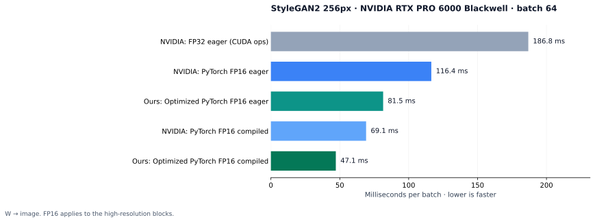
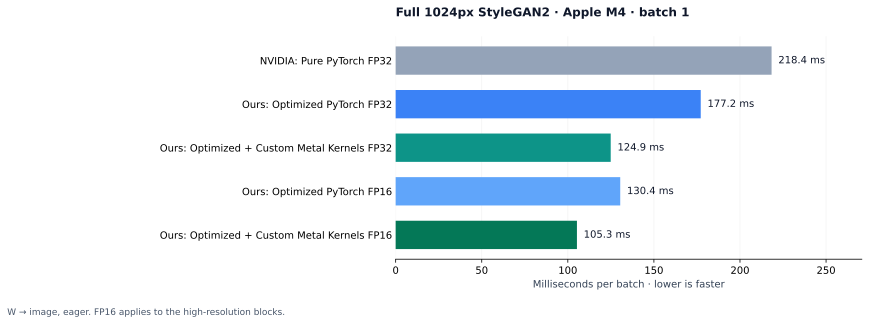
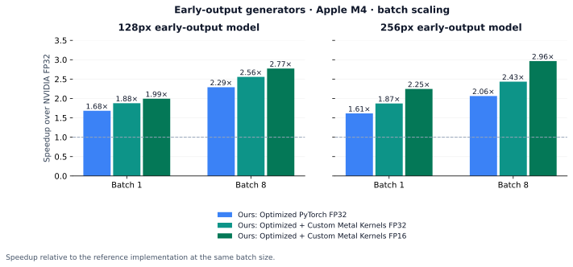

# StyleGAN2-Sobieszek

Fast StyleGAN2 inference for NVIDIA GPUs and Apple Silicon.

A rewrite of the StyleGAN2 synthesis network from
[NVIDIA StyleGAN3](https://github.com/NVlabs/stylegan3), with shared
convolutions, polyphase resampling, mixed precision and custom Metal kernels.
Loads standard NVIDIA `.pkl` and Rosinality `.pt` checkpoints.

| | Speedup |
| --- | --- |
| CUDA, batch 64, FP16 + `torch.compile` | **3.97×** |
| CUDA, forward + latent gradient | **4.78×** |
| Apple Silicon, 1024px, Metal + FP16 | **2.07×** |
| Apple Silicon, early-output models, batch 8 | **2.96×** |

## Benchmarks



At matched precision and compiler settings, the optimized synthesis alone is
1.47× faster (69.1 → 47.1 ms). BF16 reaches 46.1 ms per batch, about 1,390
images/s.



The Metal kernels alone account for 1.42× at FP32 (177.2 → 124.9 ms). At batch 4,
the optimized FP16 Metal path renders 9.7 images/s at 1024px.



The gains grow with batch size: per-sample kernels are never materialized, so
larger batches run as a single shared convolution.

Raw measurements are in [`benchmarks/data`](benchmarks/data);
`python benchmarks/plot_results.py` regenerates the figures.

## What changed

- **Shared convolutions.** Modulation is applied to activations instead of
  weights, so the whole batch shares one convolution and demodulation becomes a
  small matrix product.
- **Polyphase upsampling.** The 3×3 kernel and 4×4 FIR are folded into four phase
  kernels followed by a pixel shuffle, replacing the zero-insert/filter sequence.
- **Prepared weights.** Each layer caches only the weights and FIR layout for the
  active precision, and rebuilds them when the source weights change.
- **Mixed precision.** FP32, FP16 or BF16 per call, on CUDA and MPS.
- **Metal kernels.** Native `bias_act` and `upfirdn2d` for Apple Silicon (M1 and
  later), encoded on PyTorch's MPS stream with no per-op synchronization. Covers
  first and second derivatives, NCHW and channels-last.
- **`torch.compile`.** The pure PyTorch operator path traces cleanly.

Latent gradients are supported, so projection and latent optimization run on the
fast path. Weight training uses the original synthesis network.

## Usage

```bash
pip install -e .
```

```python
import torch
from stylegan2_sobieszek.early_output_model import _load_full_source_generator

G = _load_full_source_generator("stylegan2-ffhq-1024x1024.pkl").to("mps")  # or "cuda"

with torch.inference_mode():
    z = torch.randn(8, G.z_dim, device="mps")
    ws = G.mapping(z, None, truncation_psi=0.7)
    img = G.synthesis(ws, noise_mode="const", low_precision="fp16")
```

Requires Python 3.10+ and PyTorch 2.8+. The native kernels compile on first use;
on macOS this needs the Xcode command-line tools.

## License

Derived from [NVIDIA StyleGAN3](https://github.com/NVlabs/stylegan3) and
[StyleGAN2-ADA](https://github.com/NVlabs/stylegan2-ada-pytorch), and distributed
under the [NVIDIA Source Code License](LICENSE.txt) for non-commercial research use.
`legacy_model.py` and `op/` adapt
[rosinality/stylegan2-pytorch](https://github.com/rosinality/stylegan2-pytorch)
([MIT](LICENSES/Rosinality-MIT.txt)). This project is not affiliated with NVIDIA.

If you use this code, please cite the original work:

```bibtex
@inproceedings{Karras2020stylegan2,
  title     = {Analyzing and Improving the Image Quality of {StyleGAN}},
  author    = {Tero Karras and Samuli Laine and Miika Aittala and Janne Hellsten and Jaakko Lehtinen and Timo Aila},
  booktitle = {Proc. CVPR},
  year      = {2020}
}
```
